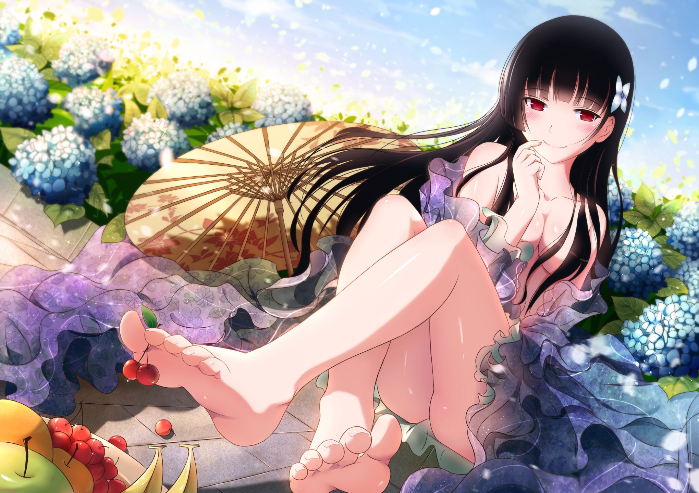
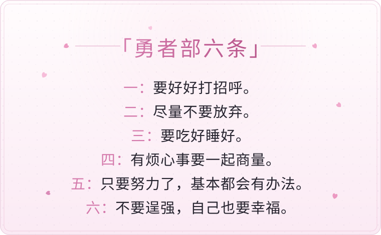
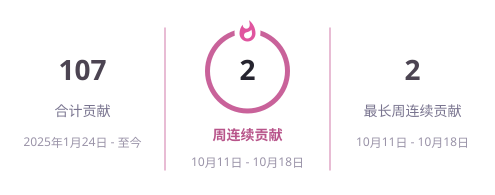

<!-- 路弥 · 墨染樱 ｜ 设计规范与维护流程见 .claude/skills/profile-readme-design/ -->

<!-- ① 墨夜樱 手绘横幅（明/暗两版，内嵌霞鹜文楷子集） -->
<picture>
  <source media="(prefers-color-scheme: dark)" srcset="./assets/hero-dark.svg">
  <source media="(prefers-color-scheme: light)" srcset="./assets/hero-light.svg">
  
</picture>

&nbsp;

<!-- ② 打字机（明/暗两种配色） -->
<picture>
  <source media="(prefers-color-scheme: dark)" srcset="https://readme-typing-svg.demolab.com?font=Fira+Code&size=27&pause=1000&width=435&center=true&background=00000000&color=F5C2E7&lines=%E6%88%91%E7%9F%A5%E9%81%93%E7%9A%84%E6%9C%80%E6%B8%A9%E6%9A%96%E7%9A%84%E4%B8%80%E4%B8%AA%E5%AD%97%E6%98%AF%E7%88%B1;%E4%B8%A4%E4%B8%AA%E5%AD%97%E6%98%AF%E5%8A%A8%E6%BC%AB;%E4%B8%89%E4%B8%AA%E5%AD%97%E6%98%AF%E4%BA%8C%E6%AC%A1%E5%85%83">
  <source media="(prefers-color-scheme: light)" srcset="https://readme-typing-svg.demolab.com?font=Fira+Code&size=27&pause=1000&width=435&center=true&background=00000000&color=D16D9E&lines=%E6%88%91%E7%9F%A5%E9%81%93%E7%9A%84%E6%9C%80%E6%B8%A9%E6%9A%96%E7%9A%84%E4%B8%80%E4%B8%AA%E5%AD%97%E6%98%AF%E7%88%B1;%E4%B8%A4%E4%B8%AA%E5%AD%97%E6%98%AF%E5%8A%A8%E6%BC%AB;%E4%B8%89%E4%B8%AA%E5%AD%97%E6%98%AF%E4%BA%8C%E6%AC%A1%E5%85%83">
  
</picture>

&nbsp;

&nbsp;

<!-- ③ 散华礼弥 -->

&nbsp;

&nbsp;

<!-- ④ 关于我：三块内容卡（勇者部六条 / 喜欢的句子 / 妹控二十条） -->
### 🌸 关于我

<picture>
  <source media="(prefers-color-scheme: dark)" srcset="./assets/rule6-dark.svg">
  <source media="(prefers-color-scheme: light)" srcset="./assets/rule6-light.svg">
  
</picture>

&nbsp;

<picture>
  <source media="(prefers-color-scheme: dark)" srcset="./assets/quotes-dark.svg">
  <source media="(prefers-color-scheme: light)" srcset="./assets/quotes-light.svg">
  
</picture>

&nbsp;

<picture>
  <source media="(prefers-color-scheme: dark)" srcset="./assets/rule20-dark.svg">
  <source media="(prefers-color-scheme: light)" srcset="./assets/rule20-light.svg">
  
</picture>

&nbsp;

&nbsp;

<!-- ⑤ 统计卡（CI 每日自产，见 .github/workflows/cards.yml） -->
<picture>
  <source media="(prefers-color-scheme: dark)" srcset="./profile/stats-dark.svg">
  <source media="(prefers-color-scheme: light)" srcset="./profile/stats-light.svg">
  
</picture>
<picture>
  <source media="(prefers-color-scheme: dark)" srcset="./profile/streak-dark.svg">
  <source media="(prefers-color-scheme: light)" srcset="./profile/streak-light.svg">
  
</picture>

&nbsp;

&nbsp;

<!-- ⑥ 贡献图贪吃蛇（output 分支，CI 生成） -->
<picture>
  <source media="(prefers-color-scheme: dark)" srcset="https://raw.githubusercontent.com/LumiACGN/LumiACGN/output/github-contribution-grid-snake-dark.svg">
  <source media="(prefers-color-scheme: light)" srcset="https://raw.githubusercontent.com/LumiACGN/LumiACGN/output/github-contribution-grid-snake.svg">
  
</picture>

&nbsp;

&nbsp;

<!-- ⑦ 徽章 -->

&nbsp;

&nbsp;

墨染樱下，与君初见 🌸

