<!-- 路弥 · 墨染樱 ｜ 设计规范与维护流程见 .claude/skills/profile-readme-design/ -->

<!-- ① 墨夜樱 手绘横幅（明/暗两版，内嵌霞鹜文楷子集） -->
<picture>
  <source media="(prefers-color-scheme: dark)" srcset="./assets/hero-dark.svg">
  <source media="(prefers-color-scheme: light)" srcset="./assets/hero-light.svg">
  
</picture>

&nbsp;

<!-- ② 世界観卡：礼弥 + 自制打字题词 -->
<picture>
  <source media="(prefers-color-scheme: dark)" srcset="./assets/stage-dark.svg">
  <source media="(prefers-color-scheme: light)" srcset="./assets/stage-light.svg">
  
</picture>

&nbsp;

<!-- ④ 关于我：三块内容卡（勇者部六条 / 喜欢的句子 / 妹控二十条） -->
### 🌸 关于我

<picture>
  <source media="(prefers-color-scheme: dark)" srcset="./assets/rule6-dark.svg">
  <source media="(prefers-color-scheme: light)" srcset="./assets/rule6-light.svg">
  
</picture>

&nbsp;

<picture>
  <source media="(prefers-color-scheme: dark)" srcset="./assets/quotes-dark.svg">
  <source media="(prefers-color-scheme: light)" srcset="./assets/quotes-light.svg">
  
</picture>

&nbsp;

<picture>
  <source media="(prefers-color-scheme: dark)" srcset="./assets/rule20-dark.svg">
  <source media="(prefers-color-scheme: light)" srcset="./assets/rule20-light.svg">
  
</picture>

&nbsp;

&nbsp;

<!-- ⑤ 统计卡（CI 每日自产，见 .github/workflows/cards.yml） -->
<picture>
  <source media="(prefers-color-scheme: dark)" srcset="./profile/stats-dark.svg">
  <source media="(prefers-color-scheme: light)" srcset="./profile/stats-light.svg">
  
</picture>
<picture>
  <source media="(prefers-color-scheme: dark)" srcset="./profile/streak-dark.svg">
  <source media="(prefers-color-scheme: light)" srcset="./profile/streak-light.svg">
  
</picture>

&nbsp;

&nbsp;

<!-- ⑥ 贡献图贪吃蛇（output 分支，CI 生成） -->
<picture>
  <source media="(prefers-color-scheme: dark)" srcset="https://raw.githubusercontent.com/LumiACGN/LumiACGN/output/github-contribution-grid-snake-dark.svg">
  <source media="(prefers-color-scheme: light)" srcset="https://raw.githubusercontent.com/LumiACGN/LumiACGN/output/github-contribution-grid-snake.svg">
  
</picture>

&nbsp;

&nbsp;

<!-- ⑦ 徽章 -->

&nbsp;

&nbsp;

🌸 未曾初恋，却已失恋 🌸

